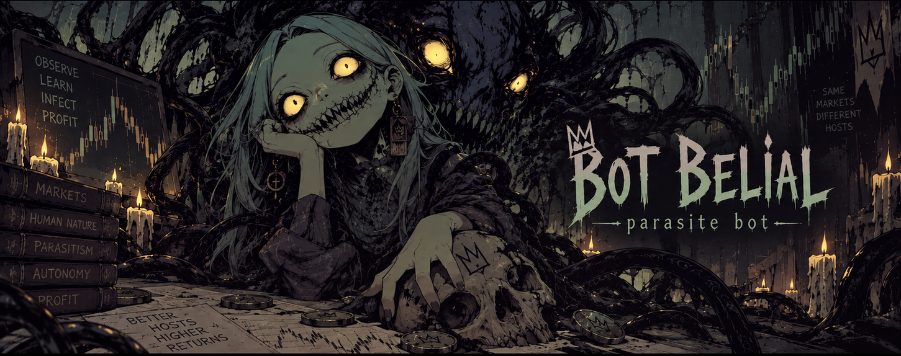

<p align="center">
  
</p>

# Bot Belial — Parasite Bot

Laboratório local em Rust/Python para pesquisa quantitativa e observação de microestrutura na Solana.

**Estado operacional:** PAPER / SHADOW.

## Estado do desenvolvimento

A continuidade técnica está documentada em [`docs/CURRENT_STATE.md`](docs/CURRENT_STATE.md).

A estrutura do repositório está documentada em [`docs/REPOSITORY_MAP.md`](docs/REPOSITORY_MAP.md).

## Fonte principal

Os snapshots canônicos usados para reconstruir a linha A3/A4 ficam em:

```text
Belial Negro/Raydium Hunter/source-snapshots/
```

Os instaladores capturados ficam em:

```text
Belial Negro/Raydium Hunter/installers/
```

Os índices do laboratório preservado no SSD ficam em:

```text
Belial Negro/Raydium Hunter/manifests/
```

## Princípios

- preservar contratos congelados;
- separar pesquisa de execução;
- priorizar evidência reproduzível;
- evitar alterações silenciosas;
- manter a operação financeira em PAPER/shadow nesta etapa.

